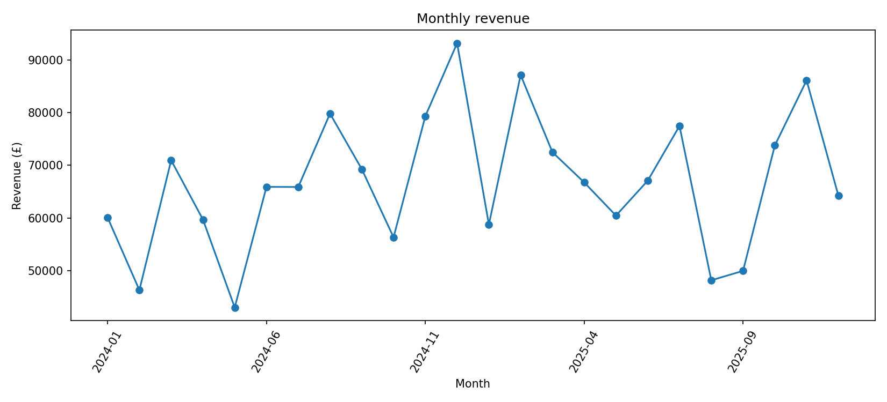

# UK Retail Sales Analytics | End-to-End Data Analyst Portfolio

**Excel • SQL • Python • Power BI • Tableau**  
**Dataset:** fictional / synthetic UK retail orders, 2024–2025. **This is a learning and portfolio project, not client work.**

## Business question
How can a fictional UK retail business improve its sales and profitability using order-level transaction data? The same dataset is explored across five common analyst tools to compare outcomes and communicate actionable findings.

## Headline results (unfiltered, 2024–2025)
| Metric | Value |
|---|---:|
| Sales revenue | £1,601,846.50 |
| Profit | £415,491.52 |
| Profit margin | 25.94% |
| Unique orders | 2,500 |
| Sales growth, 2025 vs. 2024 | 2.87% |

## Key findings
1. **Technology** leads sales at £928,057.25, although revenue leadership does not automatically imply the highest margin.
2. **North** leads regional revenue at £584,072.60.
3. **Laptop** is the leading product by revenue at £712,908.00.
4. Overall revenue rose **2.87%** from 2024 to 2025, within the limits of this simulated dataset.

## Project folders
| Folder | Contents |
|---|---|
| [`data/`](data/) | Source CSV (2,500 synthetic orders) |
| [`excel/`](excel/) | Excel workbook with sales analysis and charts |
| [`sql/`](sql/) | SQLite database and reproducible analytical SQL |
| [`python/`](python/) | Jupyter notebook, analysis script and requirements |
| [`powerbi/`](powerbi/) | DAX measures and step-by-step dashboard build guide |
| [`tableau/`](tableau/) | Calculated fields and step-by-step dashboard build guide |
| [`visuals/`](visuals/) | Generated charts and HTML dashboard demonstration |
| [`reports/`](reports/) | Business findings and methodology |
| [`career/`](career/) | LinkedIn copy, CV bullets and publishing checklist |

## Tool-by-tool workflow
**Excel:** load the CSV, inspect fields, summarise results, build KPI and category/regional charts.  
**SQL:** check completeness, aggregate orders, compare months, rank products and explore discount performance.  
**Python:** validate records, calculate KPIs, chart monthly sales and product mix with Pandas/Matplotlib.  
**Power BI:** model the Sales table against a calendar table and create DAX-based executive and profitability dashboards.  
**Tableau:** build equivalent KPIs, sales charts, product views and interactivity.

> **Important verification note:** This repository includes starter DAX, Tableau calculations, and build guides. It **does not yet contain native `.pbix` or `.twbx` workbooks**. Add your completed dashboard files to their folders before describing them as downloadable source files. Screenshots should be exported from your real dashboards, not generated mockups.

## How to reproduce
1. Start from [`data/sales_data.csv`](data/sales_data.csv). Keep its field names lowercase (e.g. `sales`, `profit`, `order_date`).
2. Open the Excel workbook or import CSV into Excel.
3. Open [`sql/sales_portfolio.sqlite`](sql/sales_portfolio.sqlite) in DB Browser for SQLite; run [`analysis.sql`](sql/analysis.sql).
4. Install Python dependencies with `pip install -r python/requirements.txt`; run the notebook from the repository root or adjust the CSV path as necessary.
5. Follow the Power BI and Tableau guides, linking both dashboards to this same CSV.
6. Verify all platforms show £1,601,846.50 revenue and £415,491.52 profit **with all filters cleared**.

## Recommendations
- Prioritise margin review alongside revenue for high-volume products.
- Investigate why North leads in sales and whether its product mix is transferable to other regions.
- Track year-over-year trend and discount profitability before recommending any price changes.

## Limitations
The dataset is entirely **synthetic**, so insights illustrate analytical methods, not actual UK retail market conditions. No causal claims can be inferred from the descriptive analysis. The five tools here are five views of **one integrated project**, not five unrelated client projects.

## Repository owner
Replace this with your name, portfolio link, contact information and (once published) live Power BI/Tableau dashboard links.

## Expanded portfolio materials
- [Interactive portfolio website](website/index.html) — standalone HTML demo built from the actual synthetic order-level CSV (works locally; publish via GitHub Pages as described below).
- [GitHub publishing instructions](guides/GITHUB_PUBLISHING.md)
- [Power BI visual polish guide](guides/POWER_BI_POLISH.md)
- [Tableau visual polish guide](guides/TABLEAU_POLISH.md)
- [Complete rebuild from scratch guide](guides/REBUILD_FROM_SCRATCH.md)
- [CV, LinkedIn and interview kit](career/CV_LINKEDIN_INTERVIEW_UPGRADE.md)

**Publishing status:** Repository and website are prepared but have not been pushed to your GitHub account. Add your own native Power BI/Tableau files before presenting them as included downloads.

## 2026 senior portfolio enhancement
- [Executive dashboard chart](visuals/executive_dashboard_review.png)
- [Product revenue/profit chart](visuals/product_profit_scatter.png)
- [Decision memo](senior_analytics/BUSINESS_CASE.md)
- [Data quality report](senior_analytics/DATA_QUALITY.md)
- [Advanced SQL](senior_analytics/senior_sql.sql)
- [Senior Python analysis](senior_analytics/analyze_senior.py)
- [Website publication and QA](guides/WEBSITE_REVIEW.md)
- [GitHub final steps](guides/GITHUB_FINAL_STEPS.md)
- [Interview preparation](interview/SENIOR_DATA_ANALYST_QA.md)

The Power BI and Tableau workbook files are not included: add your real exported workbooks before claiming them as repository deliverables. All data is synthetic.
